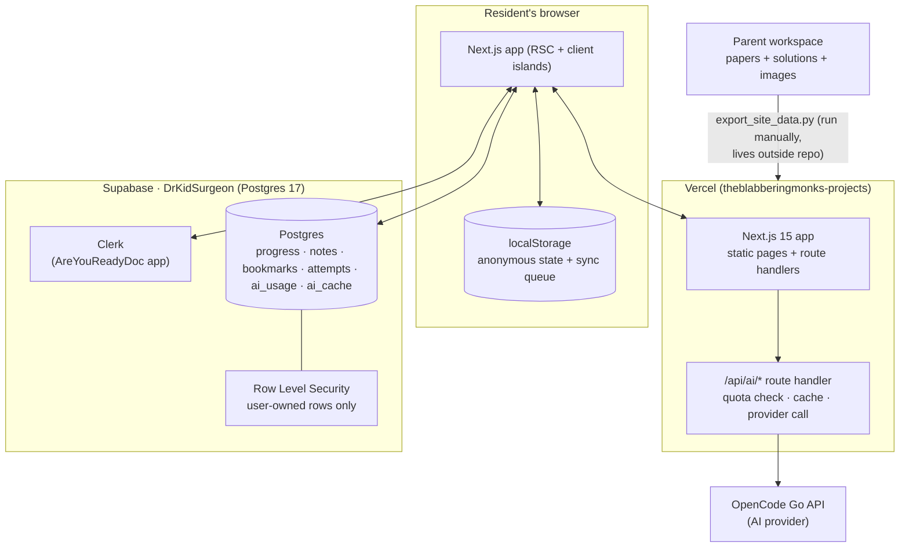

# 03 — Architecture

## System context



Key property: **the reading path never depends on the network after first
load.** Supabase and the AI provider can both be down and a resident can still
read, revise, and sit a mock exam.

## Tech stack

| Layer | Choice | Rationale |
|---|---|---|
| Framework | Next.js 15 (App Router), React 19, TypeScript | Already scaffolded; RSC for content pages = tiny client JS |
| Language | TypeScript strict | The current `app/*.jsx` hello-world is replaced |
| Styling | CSS Modules or vanilla-extract; no utility-framework lock-in | Editorial design, small bundle, no class soup |
| Markdown | `react-markdown` + `remark-gfm` (build-time rendered where possible) | Answers are markdown with tables |
| Search | FlexSearch, index built at export time into `data/search-index.json` | Instant, offline, zero infra |
| Auth | Clerk (`AreYouReadyDoc` app): prebuilt sign-in/sign-up, modal buttons + `UserButton` | No passwords or SMTP to run; social providers available (see ADR-0004) |
| DB | Supabase Postgres + RLS | Already provisioned (`DrKidSurgeon`); Phase 2 wires Clerk JWT → RLS (see ADR-0004) |
| DB | Supabase Postgres + RLS | Already provisioned (`DrKidSurgeon`) |
| Client sync | Thin custom sync layer over `fetch`; no realtime subscriptions in v1 | Progress is low-frequency; polling/queue is simpler and cheaper |
| AI | Vercel route handler → OpenCode Go; Vercel AI SDK if endpoint is OpenAI-compatible (**spike P0-T3**) | Key stays server-side |
| Hosting/CDN | Vercel (Hobby) | Zero-config Next.js, preview deploys per PR |
| Analytics | Vercel Analytics only | Privacy-respecting, no cookie banner |

## Content pipeline (build-time, not runtime)

```
workspace/solution/**  ──export_site_data.py──▶  repo/data/** + repo/public/assets/**
                                                   │
                                                   ▼
                                    Next.js build: library/topics/lessons
                                    pre-rendered; paper JSON lazy-loaded
                                                   │
                                                   ▼
                                          Vercel CDN (immutable assets)
```

- `export_site_data.py` lives in the **parent workspace**, never in the repo.
  Running it is a manual, reviewable step (`python3 ../export_site_data.py`).
- Paper JSON is fetched per-paper at runtime (`/data/papers/NN.json` served as
  a static asset), so adding paper 18 doesn't bloat the library page.
- Images are pre-optimized WebP (≤1200px) by the export script; SVG figures are
  inlined. No next/image runtime optimizer needed for these (static + cached).

## Application shape

```
app/
  (marketing)/page.tsx            → /            library = home; no separate landing
  papers/[id]/page.tsx            → /papers/01   reading + progress (RSC shell)
  papers/[id]/mock/page.tsx       → /papers/01/mock
  topics/page.tsx, topics/[slug]/page.tsx
  lessons/page.tsx, lessons/[slug]/page.tsx
  search/ (client island, command-K palette + page)
  bookmarks/page.tsx
  sign-in/[[...sign-in]]/page.tsx, sign-up/[[...sign-up]]/page.tsx (Clerk catch-all routes)
  api/sync/route.ts               → batched progress/notes/bookmarks sync
  api/ai/explain/route.ts         → AI proxy (see 06)
lib/
  content/   → typed loaders over data/*.json (zod-validated at build)
  progress/  → local store + sync engine (anonymous-first)
  supabase/  → browser + server clients (publishable key only in browser)
```

## Security model

- **AI key**: `OPENCODE_GO_API_KEY` in Vercel env, referenced only in route
  handlers (server). Never prefixed `NEXT_PUBLIC_`. See
  [ADR-0003](adr/0003-ai-key-handling.md).
- **Supabase**: browser uses the publishable anon key; every user table has RLS
  policies `auth.uid() = user_id`. Service-role key exists only in Vercel env
  for quota bookkeeping, never in the browser.
- **Sync endpoint**: accepts batched ops for the authenticated user only;
  server validates and applies idempotently (upsert on natural keys).
- **Content**: read-only, public, build-time — no injection surface. Markdown
  rendered with raw HTML disabled.
- **Headers**: default Vercel security headers + CSP allowing self + Supabase +
  inline SVG.

## Deployment & environments

| Env | Trigger | URL | Notes |
|---|---|---|---|
| Preview | every PR | `*.vercel.app` | Shares the same Supabase project (low risk at this scale; revisit if write volume grows) |
| Production | merge to `main` | custom domain TBD | Protected by Vercel Authentication until public launch |

**Pre-deploy blocker**: the Vercel MCP connection currently gets 403 on team
`theblabberingmonks-projects` — re-authorize team access (or use the Vercel
CLI login) before the first deploy. GitHub repo `theblabberingmonk/drnb_paediatric_surgery_exam`
connects to Vercel for git-push deploys.

Env vars (names only — values in Vercel dashboard / local `.env.local`,
never committed): `NEXT_PUBLIC_SUPABASE_URL`, `NEXT_PUBLIC_SUPABASE_ANON_KEY`,
`SUPABASE_SERVICE_ROLE_KEY`, `OPENCODE_GO_API_KEY`,
`NEXT_PUBLIC_CLERK_PUBLISHABLE_KEY`, `CLERK_SECRET_KEY`.
**Production blocker:** the Clerk dev keys in local `.env.local` do not work on
Vercel — set production Clerk keys (plus the Supabase and AI keys) in the
Vercel project env vars before launch (see ADR-0004).

Vercel variable types (Config vs Secret): `NEXT_PUBLIC_*` must be **Config**
(the prefix forces the value into the browser bundle — correct for Clerk
publishable and Supabase anon keys, which are public by design).
`CLERK_SECRET_KEY` and `SUPABASE_SERVICE_ROLE_KEY` must be **Secret** with no
public prefix. Changing any `NEXT_PUBLIC_*` value requires a fresh build
(git push always rebuilds; dashboard Redeploy must run *without* build cache).

## Failure-mode plan

| Failure | Blast radius | Mitigation |
|---|---|---|
| Supabase outage | Sync + sign-in only | Local-first design; queue + retry; reading unaffected |
| AI provider outage | AI feature only | Feature-flag off; inline graceful message |
| Bad content export | Wrong answers shown | Export is manual + diff-reviewed; zod validation at build fails loudly |
| Vercel Hobby limit hit | Site down | Unlikely at this traffic; static content is CDN-cheap; upgrade path is $20/mo |
| Region latency (DB in us-west-2, users in India) | Sync feels slow (~250ms RTT) | Sync is async and non-blocking; reads are local. Do not over-engineer; a region move is a checkbox later if it matters |

## Risks

| Risk | Mitigation |
|---|---|
| Original NBE questions are NBE copyright | Show prompts as short educational excerpts with attribution; host no PDFs; answers and illustrations are original work. If challenged, prompts can be paraphrased without architecture change (they're data, not code) |
| AI answers could be wrong | AI only elaborates on human-authored answers, is labeled as AI, and carries a disclaimer; thumbs-down feedback captured |
| Scope creep (forum, MCQs, payments) | Non-goals in 01 are contractual; new scope requires a new ADR |
| Single-maintainer bus factor | Everything documented here; infra is two managed services; export script is deterministic |
